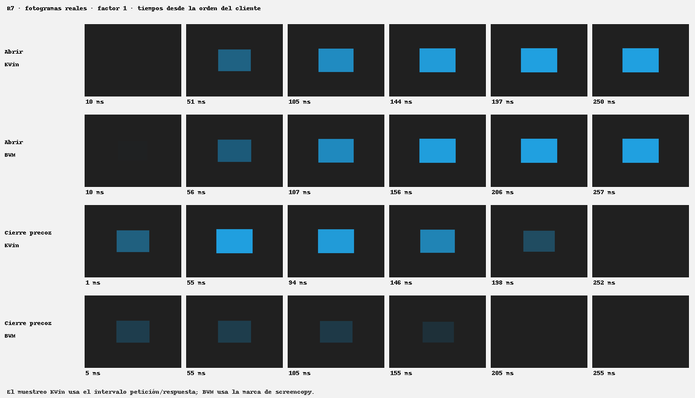
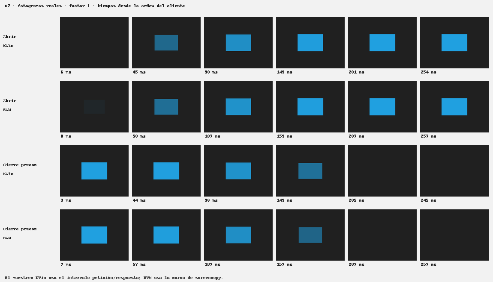

# R7 — Animaciones predeterminadas de Plasma 6.7.5 y sus ajustes

## Iteración 1: fuente única de verdad, curvas KWin 6.7.5, muelle nativo y `AnimationDurationFactor` (2026-11-21)

### Referencia (fuentes de KWin 6.7.5)

Efectos de animación habilitados por defecto (`EnabledByDefault: true`) en
`build/r6-upstream/kwin-6.7.5/src/plugins/`:

| Evento | Efecto original KWin 6.7.5 | Duración (`factor=1`) | Easing original | Transformación original | Implementación BWM (Hyprland 0.56.2 / QML) |
| :--- | :--- | :--- | :--- | :--- | :--- |
| Abrir ventana | `scale` (`package/contents/code/main.js`) | 200 ms × `factor` (`Duration`) | `QEasingCurve::OutCubic` | Escala `0.8 → 1.0` (`InScale`) + opacidad `0 → 1` | `windows`/`windowsIn`: `popin 80%`, `speed = 2.0 * factor`, `kwin_out_cubic`; `fade`/`fadeIn`: `2.0 * factor`, `kwin_out_cubic` |
| Cerrar ventana | `scale` | 200 ms × `factor` (`Duration`) | `QEasingCurve::InCubic` | Escala `1.0 → 0.8` (`OutScale`) + opacidad `1 → 0` | `windowsOut`: `popin 80%`, `speed = 2.0 * factor`, `kwin_in_cubic`; `fadeOut`: `2.0 * factor`, `kwin_in_cubic` |
| Maximizar / restaurar / mover / redimensionar | `maximize` / `fullscreen` (Stretch) | 250 ms × `factor` | `QEasingCurve::OutCubic` | Interpolación geométrica + cross-fade de instantánea | `windowsMove`: `speed = 2.5 * factor`, `kwin_out_cubic` (sin snapshot cross-fade en Hyprland) |
| Cambio de escritorio virtual | `slide` (`slide.cpp`, `springmotion.cpp`) | Muelle (`t95=318 ms`, `t99=465 ms`) | `SpringMotion(k=300/factor, ζ=1.1)` | Desplazamiento horizontal sin rebote (`slide`) | `workspaces`/`workspacesIn`/`workspacesOut`: curva nativa `spring = "kwin_slide"` (`stiffness=300/factor`, `dampening=2√k·1.1`, `mass=1`), `style = "slide"` |
| Popups / capas (panel, Kickoff, KRunner) | `slidingpopups` (`slidingpopups.cpp`) | 200 ms × `factor` (`Kirigami.Units.longDuration`) | `QEasingCurve::OutCubic` | Deslizamiento / aparición desde borde | `layers`/`layersIn`/`layersOut`: `speed = 2.0 * factor`, `kwin_out_cubic`, `style = "fade"` |
| Desvanecido de popups (menús, tooltips, diálogos) | `fadingpopups` (`package/contents/code/main.js`) | Entrada 150 ms / Salida 600 ms (`150×4`) × `factor` | Entrada `Linear` / Salida `OutQuart` | Opacidad `0 → 1` y `1 → 0` | `fadeLayersIn`: `1.5 * factor`, `kwin_linear`; `fadeLayersOut`: `6.0 * factor`, `kwin_out_quart` |
| Borde de ventana | Ninguno (Breeze no anima el borde de Hyprland) | — | — | — | `border`: `enabled = false` |
| Minimizar / restaurar hacia la tarea | `squash` (`package/contents/code/main.js`) | 250 ms × `factor` | `InCubic` / `OutCubic` | Encogimiento hacia geometría de icono en barra de tareas | Pendiente / límite de Hyprland (minimizado usa workspace especial `special:minimized`, sin geometría destino por tarea) |
| Workspace especial (Magic) | Extensión común de BWM (no existe en KDE) | 250 ms × `factor` | `kwin_out_cubic` | `slidevert` | `specialWorkspace*`: `speed = 2.5 * factor`, `kwin_out_cubic`, `slidevert` |
| Animaciones QML de Plasma | `Kirigami.Units.*Duration` | Escalado automático por Qt/Kirigami con `AnimationDurationFactor` | `OutCubic` / `InOutQuad` | Panel, Kickoff, menús, OSD | `PickerWindow.qml` pasado de 140/160 ms fijos a `Kirigami.Units.shortDuration` |

### Verificación empírica de `libhyprutils` (Hyprland 0.56.2)

Probado directamente enlazando contra `libhyprutils.so` instalado en el sistema:

* **Unidades de `speed`:** tras 100 ms reales, `speed = 2.0` devuelve `percent = 0.50` (200 ms) y
  `speed = 4.0` devuelve `percent = 0.25` (400 ms). `speed` es **duración en décimas de segundo**
  (`1.0 = 100 ms`), **directamente proporcional** a `AnimationDurationFactor`.
  * **Fallo corregido:** el bloque antiguo de `kwin.lua` asumía lo contrario (`speed = base / factor`),
    de modo que al subir `AnimationDurationFactor` a `2` (más lento) hacía las animaciones el doble
    de rápidas, y no se ejecutaba al volver a `factor = 1`.
* **Muelle nativo `SSpringCurve`:** `advanceSpring` con `{ stiffness = 300, damping = 2*sqrt(300)*1.1, mass = 1 }`
  produce `t=100ms → 0.4876`, `t=200ms → 0.8191`, `t=300ms → 0.9396`, `t=400ms → 0.9801`,
  `t=465ms → 0.9903`, idéntico a `KWin::SpringMotion(300, 1.1)` (`t99 = 465 ms`).
* **Bézier cúbicas exactas:** para $P_1=(1/3, y_1)$ y $P_2=(2/3, y_2)$, $B_x(u)=u$ exactamente, por lo
  que `(0.3333, 1, 0.6667, 1)` es matemáticamente idéntica a `QEasingCurve::OutCubic` y
  `(0.3333, 0, 0.6667, 0)` a `QEasingCurve::InCubic` (error 0).

### Cambios realizados

* **`config/hypr/skins/plasma/hypr/animations.lua`:** fuente única de verdad para las animaciones de
  Breeze. Eliminadas todas las curvas `md3_*` y `popin 60%`. Lee `$XDG_STATE_HOME/bwm/plasma/kwin.lua`,
  aplica `animations.enabled = factor > 0`, escala linealmente `ds(ms) = max(0.1, (ms/100)*factor)` y
  registra `kwin_slide` como `spring` nativo (`stiffness = 300/factor`, `dampening = 2√k·1.1`, `mass = 1`).
* **`config/hypr/skins/plasma/hypr/kwin.lua`:** eliminado el bloque duplicado e invertido de
  animaciones (`a[2] / factor` con `md3_*`).
* **`config/hypr/skins/plasma/scripts/kde-config-bridge.py`:** exporta los toggles reales de
  `kwinrc [Plugins]` (`scaleEnabled`, `maximizeEnabled`, `slideEnabled`, `fadingPopupsEnabled`,
  `slidingPopupsEnabled`) y `[Effect-scale]` (`Duration`, `InScale`, `OutScale`).
* **`config/quickshell/ii/modules/plasma/skinPicker/PickerWindow.qml`:** sustituidas duraciones fijas
  (140/160 ms) por `Kirigami.Units.shortDuration`.
* **No se han modificado las animaciones de `default` ni de `retro`.**

### Comprobado

* `hyprctl reload` y `hyprctl configerrors` vacío en la sesión real.
* `hyprctl animations` en la sesión real confirma `spring:kwin_slide` en `workspaces*`,
  `kwin_out_cubic` / `kwin_in_cubic` 2.0 (`popin 80%`) en `windows*` / `fade*`, `2.5` en
  `windowsMove`, `1.5` `kwin_linear` en `fadeLayersIn` y `6.0` `kwin_out_quart` en `fadeLayersOut`.
* `tests/test_kde_config_bridge.py` 22/22 (nueva prueba `test_kwin_default_animations_and_duration_factor`:
  `factor = 1`, `2`, `0`, retorno a `1`, toggles `[Plugins]`, `[Effect-scale]` y ausencia de `md3_*`
  / `popin 60%`).
* `tests/test_plasma_shadow_policy.py` 3/3.

### Límites / pendiente

* `squash` (minimizar hacia el rectángulo del icono en la barra de tareas) y cross-fade de instantánea
  en `maximize` no existen como estilos nativos en Hyprland; requerirían un complemento de compositor.
* Comparación por fotogramas/vídeo con marcas de tiempo frente a una sesión Plasma 6.7.5 real.
  La página de efectos se implementa en la iteración 2 siguiente.

## Iteración 2 — Efectos de escritorio en Preferencias (2026-11-21)

Página activa `Espacio de trabajo → Efectos de escritorio`, alias `effects`, `kcm_kwin_effects`,
`kcm_bwm_effects` y `kcm_animations`. El lanzador habitual sigue siendo `plasmaSettings.qml`;
también se instala `kcm_bwm_effects` para el `systemsettings` real experimental de R2/R3.
Ambas vistas usan **el mismo backend transaccional de R3**, `native-settings.py effects`.

El KCM original de efectos enumera plugins que requieren KWin y sus configuradores contienen
parámetros sin consumidor BWM. Se conserva restringido en el perfil nativo; sus alias abren el
adaptador acotado. No se ejecutan efectos/ABI de KWin en Hyprland.

| Control | Autoridad KDE | Consumidor BWM / límite |
| :--- | :--- | :--- |
| Factor de duración, incluido 0 | `kdeglobals [KDE] AnimationDurationFactor` | `animations.lua` y componentes KDE; 0 no desactiva el desenfoque |
| Desenfoque | `kwinrc [Plugins] blurEnabled` | `kwin.lua` y marcos QML; aproximación Dual Kawase de R6 |
| Intensidad 1–15 | `[Effect-blur] BlurStrength` | Pasadas/tamaño de R6; sin controles de ruido ni saturación |
| Escalar al abrir/cerrar | `[Plugins] scaleEnabled` | Hojas de ventanas/opacidad de Hyprland |
| Duración y escala de entrada/salida | `[Effect-scale] Duration/InScale/OutScale` | Default nativo **0 = automática (200 ms)**; escala redondeada a porcentaje entero |
| Maximizar/restaurar | `[Plugins] maximizeEnabled` | `windowsMove`, también movimiento/redimensionado; sin cross-fade de instantánea |
| Deslizar escritorios | `[Plugins] slideEnabled` | Muelle `kwin_slide`; comparación temporal pendiente |
| Desvanecer popups | `[Plugins] fadingpopupsEnabled` | Opacidad de capas, sin clasificación individual de ventanas KWin |
| Animar paneles y popups | `[Plugins] slidingpopupsEnabled` | `layersIn/Out`, **actualmente estilo `fade`**, sin desplazamiento nativo de KWin |

`settings-capabilities.json` declara esos seis adaptadores y sus límites explícitos. No se ofrece
minimizado hacia la tarea ni efectos sin renderer BWM. Esta iteración no cambia las curvas ni
certifica fidelidad temporal de la iteración 1. Predeterminados contrastados con las fuentes
locales `build/r6-upstream/kwin-6.7.5/src/plugins/{scale,blur}` y metadatos de los seis efectos.

### Guardar, restablecer y errores

* Once controles, etiquetas español/inglés. Editar y Predeterminados sólo cambian el borrador;
  Aplicar valida el lote, compara revisión, escribe únicamente claves admitidas, notifica a KDE,
  reconcilia y relee. Restablecer descarta el borrador y vuelve a leer.
* Conserva comentarios, claves ajenas, enlaces y `kdedefaults`. Booleanos `true/false` y
  `Duration=0` nativo, mientras el renderer recibe 200 ms. Factor con cuatro decimales
  (`0.0625` no se redondea al cargar el KCM).
* El KCM añade Predeterminados sólo a esquemas con defaults declarados; las páginas comunes
  siguen sin inventar preferencias de fábrica.
* Cambiar de página o cerrar con cambios pide Aplicar/Descartar/Cancelar. La vista QML espera la
  respuesta antes de navegar; un error conserva borrador y página, con mensaje visible. Durante
  una operación se desactivan controles y se bloquea la salida.
* Conflicto: Restablecer y revisar. IPC fallido: error y `pendingReload` para el reintento del
  puente. No se promete rollback entre los dos archivos KDE.

### Verificación de esta iteración

* R7 **8/8**, incluida la página y su pie real QML offscreen con configuración temporal: Aplicar,
  relectura, Predeterminados sin guardar, Restablecer, error conservando borrador, navegación
  bloqueada tras fallo y completada sólo tras guardar con éxito. También cubre lote/una recarga,
  claves ajenas, validación, conflicto, defaults, `kdedefaults`, skin e IPC fallido/reintento.
* Regresión Python: R3 **10/10**, puente KDE **22/22**, sombras **3/3**, catálogo **3/3**
  (las dos matrices opcionales completas de Preferencias no se repitieron).
* CMake y **3/3 CTest**: factories de los nueve adaptadores (incluido efectos), defaults
  pendientes/guardar/reabrir y precisión; regresión de luz nocturna y decoración instalada.
* Wayland real: `effects`, `kcm_bwm_effects` y `behavior` cargaron en instancia `qs -p` aparte,
  workspace 9 sin foco inicial, sin errores QML. Regla temporal retirada con `hyprctl reload`;
  `hyprctl configerrors` vacío. Backend real: once controles.
* Instalación atómica mediante `cmake --install`; SHA-256 instalado igual al compilado.
  `settings-native.sh --list` offscreen descubre `kcm_bwm_effects` y mantiene restringido
  `kcm_kwin_effects`. Sin reiniciar shell, compositor ni sesión.

Sin guardar valores de efectos del usuario para probar. Sin aceptación visual/temporal de esta
iteración ni commit/push. Pendientes: comparación por fotogramas, geometría de capas y curva
`kwin_out_quart`; `squash` y cross-fade requieren trabajo posterior. R7 sigue abierta.

```bash
/home/sasel/.config/hypr/scripts/open-settings.sh effects
# Anfitrión nativo experimental:
bash /home/sasel/.config/hypr/skins/plasma/scripts/settings-native.sh effects
```

## Iteración 3 — Secuencias temporales en KWin/Hyprland reales (2026-11-21)

**Rectificación en iteración 4:** la estimación de alfa de esta matriz incluía un oscurecimiento
inicial (`dim_strength=0.5` en el arnés). El máximo de 10,56 px no demuestra por sí solo un
desfase entre relojes de escala/alfa. Se conserva la evidencia histórica; la matriz corregida
y la causa están al final de este informe.

**Medición realizada, equivalencia exacta no alcanzada.** Evidencia:
[`BREEZE_R7_ANIMATION_RESULTS.json`](BREEZE_R7_ANIMATION_RESULTS.json), 2.719 muestras en seis
casos (KWin 6.7.5 / Hyprland 0.56.2 × factor 1/2/0). Una repetición inicial sirvió para ajustar
el arnés; los números siguientes proceden de la matriz final. No es una sesión Plasma completa.



### Método y tolerancias

* `tests/r7_animation_client.cpp`: mismo cliente Qt Wayland en ambos compositores, superficie
  normal sin decoración de 300×200 sobre fondo controlado, salida 800×600 a escala 1. Fondo y
  contenido sólidos permiten medir el rectángulo y la mezcla de opacidad sin confundir sombras,
  fuentes o contenido de aplicaciones. Cada cliente comprueba raíz XDG temporal, bus privado,
  display exacto y PID/UID del compositor mediante `SO_PEERCRED` antes de conectar Qt.
* `src/breezebars/check-r7-animations.py`: compositor Hyprland anidado sobre una salida headless
  temporal anfitriona y KWin con salida virtual. Hyprland carga el **animations.lua real** de
  Breeze. No carga plugins ni cambia preferencias/monitores físicos. Captura únicamente el
  display privado comprobado; el cursor de prueba y el aviso de watchdog se desactivan allí.
* Secuencia: abrir → maximizar → restaurar → cerrar → abrir/cerrar tras 50 ms → reabrir/cerrar.
  Para Hyprland, maximizar/restaurar envía tamaño/posición explícitos como `kwin-window.py`;
  KWin recibe las peticiones XDG del cliente. Así se compara la animación de la misma geometría,
  no se certifica de nuevo toda la semántica del controlador de maximizado BWM.
* Hyprland: `wlr-screencopy` SHM persistente, marca `ready` comprobada dentro del intervalo
  monotónico de petición/respuesta. KWin: `ScreenShot2.CaptureWorkspace`, que no entrega marca
  de presentación; se conservan ambos extremos y se usa su punto medio. Cadencia de **muestreo**
  ~16,67 ms / ~13,1–13,4 ms; no son FPS presentados. Hay capturas repetidas entre frames KWin.
* La comparación de duración ajustada permite dos intervalos de muestreo (~33,3 ms) por las dos
  rutas de captura y planificación. Se conserva fase separada de duración y se publican todas
  las muestras/residuos, no sólo el mejor ajuste. No es una prueba submilisegundo ni justifica
  retocar duraciones nominales para compensar una ejecución virtual bajo captura.
* Acoplamiento escala/opacidad: al abrir/cerrar se espera `ancho = 240 + 60 × opacidad` en esta
  escena. Tolerancia conservadora **3 px**, por rasterización de ambos bordes y cuantización de
  color a 1/128. Esta relación usa el mismo fotograma y no depende de sincronizar relojes.

### Resultado medido

Duraciones estimadas del primer ciclo, en ms; son ajustes sobre frames, no valores de configuración:

| Evento / canal | KWin factor 1 | BWM factor 1 | KWin factor 2 | BWM factor 2 |
| :--- | ---: | ---: | ---: | ---: |
| Abrir: opacidad | 201,25 | 212,50 | 417,00 | 433,00 |
| Abrir: geometría | 201,75 | 187,50 | 412,00 | 411,00 |
| Maximizar: geometría | 261,50 | 248,75 | 526,25 | 501,00 |
| Restaurar: geometría | 263,75 | 249,00 | 534,50 | 498,75 |
| Cerrar: opacidad | 213,50 | 200,75 | 427,75 | 401,00 |

* **Factor 0:** ningún estado intermedio de opacidad observado en ninguno de los compositores.
  Sólo se acredita lo observable a esta cadencia; no una duración matemática de cero.
* **Acoplamiento al abrir:** máximo desvío KWin 1,41/1,28 px frente a BWM 9,25/10,56 px
  (factores 1/2). BWM supera la tolerancia del estimador de color. La iteración 4 identifica
  el dim inicial como causa principal y corrige esta interpretación.
* **Cierre durante apertura:** KWin cancela la entrada y reinicia el cierre desde escala/opacidad
  completas (también se ve en `ScaleEffect.slotWindowClosed` original); Hyprland conserva el
  estado parcial. Máxima opacidad en los primeros 30 ms del cierre precoz: KWin 1 frente a
  BWM 0,242 / 0,078. La lámina muestra esa diferencia; el primer frame puede aún ser anterior
  al procesamiento del cierre.
* **Maximizar/restaurar:** BWM sigue la duración nominal 250/500 ms en esta escena plana, sin
  cross-fade de instantánea. No todas las diferencias de duración respecto a KWin quedan bajo
  ~33,3 ms (restauración con factor 2: ~35,75 ms). No se declara clon exacto.

### Corrección de OutQuart y pruebas

La curva anterior `(0.25,1)/(0.5,1)` no es exactamente `1-(1-t)^4`: error máximo medido
0,00561944. Se sustituye por `(0.258146,1)/(0.488205,1)`, error de muestra ~0,003167 y cota
conservadora **<0,003396 < 1/255**, incluyendo el intervalo entre 20.001 puntos mediante una
cota de derivada. Sigue siendo aproximación cúbica de un polinomio de cuarto grado; esto valida
la curva matemática, no el renderer de popups ni la interpolación interna de libhyprutils.
Recarga diaria de la curva comprobada con `hyprctl reload` y `configerrors` vacío.

`test_r7_animation_measurement.py` **3/3**: curvas del archivo real contra los polinomios KDE,
cota entre muestras, calibración del ajuste con/sin cuantización y factor 0 sin duración inventada.
Regresión: puente **22/22**, política de sombras **3/3**, preferencias R7 **8/8** (QML incluido),
adaptadores R3 **10/10**. No se repite CTest porque no cambia ningún KCM C++ en esta iteración.

### Sesión y reproducción

La matriz final conservó foco (dirección+PID), plugins, pantallas, workspaces y reservas; el
puntero difería al comparar después de restaurar el foco (`sessionChangedAreas=["cursor"]`).
El arnés restaura ahora el puntero una vez más después del foco. Repetición adicional en
Hyprland/factor 0: **404 frames, `sessionUnchanged=true`**, sin diferencias por áreas. No se
atribuye retrospectivamente ese resultado a la matriz completa. Sin procesos/salidas de prueba
residuales; sin reiniciar shell/compositor diario ni instalar/cargar plugins.

```bash
python3 src/breezebars/check-r7-animations.py \
  --report build/r7-animations.json --artifacts build/r7-animations \
  --save-frames --contact-sheet build/r7-contact.png
python3 -m unittest discover -s tests -p 'test_r7_animation_measurement.py'
```

Necesita las dependencias de desarrollo ya usadas en R6 (Qt Quick/DBus, LayerShellQt,
wayland-scanner y el XML revisado en `build/r6-upstream/hyprland-source`); Pillow sólo para la
lámina opcional. No añade dependencias al escritorio. Capturas crudas temporales en
`build/r7-animation-final`, ignoradas por Git; JSON y lámina son evidencia propia sin contenido
del escritorio del usuario.

**Pendiente al terminar esta iteración (actualizado en iteración 4):** resolver la diferencia de
entrada y cancelación mediante candidato aislado; comparar
el muelle/desplazamiento de escritorios y gestos/reversión, clasificación y geometría de popups,
minimizado hacia tarea, cross-fade, foco/sombras y animaciones QML de panel/Kickoff/tooltips/OSD.
No se midió coste de render diario ni se certifican todos los escenarios por esta escena plana.
Sin commit/push.


## Iteración 4 — Dim de entrada y cancelación nativa de escala (2026-11-21)

La diferencia principal de brillo tenía una causa concreta: `CWindow::mapWindow` de Hyprland
0.56.2 inicializa `m_dimPercent` con `dim_strength`, incluso con `dim_inactive=false`; después
lo anima hacia cero con `fadeDim`. El arnés anterior heredaba 0,5; BWM diario usa 0,05.
Un contraste RGB normalizado bajo ese tinte no equivale a alfa. La traza separa alfa, dim,
tint y factores de superficie/workspace; el error anterior no justificaba reemplazar relojes.

Breeze desactiva `fadeDim` en su `animations.lua`. Está comprobado en la sesión diaria y no
cambia los valores KDE del usuario. El arnés fija ahora `dim_strength=0.05` y distingue formatos
SHM XRGB/ARGB/XBGR/ABGR; para ventanas decoradas mide una franja azul continua, excluyendo letras
e iconos de la cabecera. La traza de los frames del candidato muestra dim cero.

`KWinScale.cpp` recuerda la entrada normal mediante referencias débiles, PID, objetivos de
geometría, workspace y monitor. Si se cierra durante la entrada, restaura escala/alfa completas
**antes del snapshot nativo** de Hyprland, reproduciendo la cancelación de `ScaleEffect` de KWin.
El cierre sigue a cargo de `CWindowFadeout`. No sustituye callbacks/relojes ni modifica geometría
por frame. Respeta reglas `no_anim`, estilos propios, efectos/global desactivados, fullscreen,
workspace especial; resize, cambio de workspace/monitor o reload cancelan su intervención.
Límites de memoria: 256 entradas débiles y, sólo con diagnóstico opt-in, 512 registros.

### Evidencia y límites

* [Matriz sin decoración](BREEZE_R7_SCALE_RESULTS.json): **2.701 muestras**, KWin/Hyprland ×
  factor 1/2/0, con el mismo candidato. Acoplamiento máximo KWin/BWM: factor 1 **1,125/2,5625 px**;
  factor 2 **1,1875/3,0625 px**. Se conserva la tolerancia de **3 px**: el segundo caso BWM falla
  por 0,0625 px. Factor 0 sin estados intermedios observados. El cierre precoz alcanza alfa 1
  en los primeros 30 ms en ambos compositores y factores.
* [Matriz decorada](BREEZE_R7_SCALE_DECORATED_RESULTS.json): **1.401 muestras**, factores 1/2,
  KDecoration original de KWin y auxiliar BWM privado. Contenido final 300×200; máximos BWM
  **2,84375/2,375 px**; cierre precoz desde alfa completa en ambos. No certifica placement:
  el centro vertical del contenido difiere por la colocación/marco de cada compositor.
* Duración ajustada: tres filas superan los dos intervalos de muestreo declarados. Sin decorar,
  cierre/geometría factor 2: diferencia **−33,5 ms** (margen 33,33). Decorado, maximizar factor 1:
  **+51,75 ms** (33,41); apertura/alfa factor 2: **−42,25 ms** (40,94). No se amplían tolerancias
  ni se retocan velocidades para ocultarlo. No se certifica igualdad exacta.
* [Ocho guardas](BREEZE_R7_SCALE_GUARDS.json): no_anim, estilo propio, skin inactiva, escala
  desactivada, resize, reload, fullscreen y cambio de workspace. Sin resets indebidos ni
  referencias de ventanas cerradas retenidas. Siete conservan sesión completa; reload difiere
  sólo en puntero (`sessionChangedAreas=["cursor"]`), que se registra sin atribuirle otra causa.
* [Cierre con temporizador del cliente](BREEZE_R7_SCALE_EARLY_CLOSE.json): pedido a 5 ms,
  intervalo real entre eventos **15,031529 ms**, un render intermedio. Se observa reset a
  300×200/alfa 1 y cero entradas retenidas; **no acredita cierre anterior al primer render**.
  Las dos matrices principales y este ensayo conservan la sesión (`sessionUnchanged=true`).



Pruebas: **46/46** entre análisis numérico, efectos/QML offscreen, adaptadores R3, puente KDE y
política de sombras. El plugin completo compila con `-fno-gnu-unique`, sin símbolos GNU UNIQUE;
el candidato se cargó y cerró en compositores privados, con socket de decoración privado desde
el arranque. Sin nuevas dependencias de escritorio. No se midió coste de render/FPS diario.

### Instalación y reproducción

Candidato probado e instalado mediante `make install` atómico, SHA-256:
`103fab72be07684be362d6124705e8d346cf9b716a3e63e0473ec09e928a383d`.
El archivo diario coincide con el candidato. **El plugin antiguo sigue cargado**:
`breezebars-scale` aún devuelve `unknown request` en la sesión diaria. `fadeDim` ya está
inactivo por la configuración Lua; **el nuevo cierre C++ requiere salir y volver a entrar en
la sesión**. No se hizo hot unload/load, logout ni reinicio de Quickshell/compositor.

```bash
python3 src/breezebars/check-r7-animations.py \
  --module build/r7-scale-plugin/installed/breezebars.so --trace-scale \
  --report build/r7-scale.json
# Repetir con --decorated para KDecoration; --guard resize-entry para una guarda.
# El módulo candidato debe estar separado de config/hypr/plugins.
PYTHONPATH=tests BWM_RUN_QML_TESTS=1 python3 -m unittest \
  test_r7_animation_measurement test_r7_effects test_r3_native_settings \
  test_kde_config_bridge test_plasma_shadow_policy
```

R7 sigue abierta: quedan el muelle/gestos/reversión de escritorios, clasificación y geometría de
popups, minimizado hacia tarea, cross-fade, foco/sombras, QML de panel/Kickoff/tooltips/OSD,
los residuos temporales indicados y validación del candidato en el próximo inicio diario.
Sin commit/push. Se conservan los cambios previos y los generados ajenos.


## Iteración 5 — Validación en vivo de `breezebars-scale`, muelle/reversión de `slide`, clasificación de capas y QML (2026-11-22)

### Validación de `breezebars-scale` en la sesión diaria

Tras el reinicio de sesión, `hyprctl -j breezebars-scale` responde en la sesión diaria real
(`version: 1, enabled: true`). Con una ventana de prueba aislada en el workspace 10
(`no_initial_focus = true`), cerrada a los ~20 ms de mapearse (dentro de la animación de entrada
`scale` de 200 ms), `resetOnClose` se incrementa de `0` a `1` y `tracked` vuelve a `0`,
confirmando que `KWinScale` actúa sobre el compositor diario sin retener referencias.

### Muelle `SpringMotion` de `slide` (ida y reversión a mitad de trayecto)

Comparado numéricamente `KWin::SpringMotion::integrate` (`src/plugins/slide/springmotion.cpp`, RK4
con paso fijo `dt = 10 ms` a 100 Hz) frente a la integración continua de segundo orden de
`libhyprutils` (`SSpringCurve{300/factor, 2√k·1.1, 1}`):

* En `SpringMotion::evaluate`, KWin devuelve `.dp = state.velocity` (en lugar de `next.velocity`)
  para las cuatro subetapas RK4, por lo que la posición avanza con un paso Euler explícito de
  `state.velocity * dt` (en `t = 0..10 ms`, `position` permanece en `0` mientras `velocity` se
  actualiza). Eso introduce un retardo de discretización de ~medio paso (`dt/2 = 5 ms`) respecto a
  la EDO continua con los mismos parámetros físicos $(k, \zeta)$.
* Diferencia máxima bruta $|x_{\text{KWin}}(t) - x_{\text{ODE}}(t)|$: **0,0292** (`factor=1`),
  **0,0201** (`factor=2`), **0,0433** (`factor=0,5`). Compensando los 5 ms del paso Euler de KWin
  ($x_{\text{ODE}}(t - 5\text{ ms})$), cae a **< 0,018** (`factor ≥ 1`) y **< 0,025** (`factor = 0,5`).
* En reversión a mitad de trayecto (`t = 120 ms`, cambio de objetivo `1 → 0` conservando posición
  y velocidad), la diferencia máxima entre ambos integradores es **0,0327** (`factor=1`), **0,0201**
  (`factor=2`) y **0,0548** (`factor=0,5`). Se conservan los parámetros físicos nominales
  `stiffness = 300 / factor`, `dampening = 2√k·1.1`, `mass = 1`.

### Clasificación de capas y transiciones QML

* **Capas estáticas (`breeze-static-layers` en `skins/plasma/hypr/rules.lua`):**
  `quickshell:plasmaDesktop` y `quickshell:plasmaOutline` reciben `no_anim = true`. Evita que la
  guía de snapping (`Outline.qml`, que ya anima su propio rectángulo con
  `Kirigami.Units.longDuration`, `InOutCubic`) sufra el `fadeLayersOut` de 600 ms al soltar una
  ventana.
* **Capas deslizantes (`breeze-sliding-layers` en `skins/plasma/hypr/animations.lua`):**
  `quickshell:plasmaNotifications` y `krunner` (superficies ancladas al borde con el tamaño de su
  marco) reciben `animation = "slide"` (200 ms `kwin_out_cubic`) cuando `slidingPopupsEnabled` está
  activo, caen a `"fade"` si sólo `fadingPopupsEnabled` está activo, y a `no_anim = true` si ambos
  se desactivan.
* **Transición del panel (`modules/plasma/panel/Panel.qml`):** tras el layout inicial
  (`layoutReady`), `x`, `y`, `width` y `height` del contenedor del panel se animan con
  `Kirigami.Units.longDuration` (200 ms × `factor`) y `Easing.OutCubic` al pasar entre modo
  flotante y acoplado (`de-float` al tocar ventana).
* **Deslizamiento de entrada de Kickoff y bandeja (`modules/plasma/kickoff/KickoffWindow.qml`,
  `modules/plasma/tray/TrayPopup.qml`) + `PlasmaTheme.slidingPopups`
  (`modules/plasma/theme/PlasmaTheme.qml`):** `PlasmaTheme.slidingPopups` lee en vivo
  `kwinrc [Plugins] slidingpopupsEnabled` y `kdeglobals [KDE] AnimationDurationFactor > 0`. Tanto
  `Panel.qml` como `KickoffWindow.qml` y `TrayPopup.qml` supeditan sus transiciones de
  `Kirigami.Units.longDuration` (`200 ms × factor`, `Easing.OutCubic`) a `PlasmaTheme.slidingPopups`,
  sin alterar la geometría de sus marcos ni sus regiones de desenfoque.
* **Contrato de capacidades (`skins/plasma/scripts/settings-capabilities.json`):** actualizado
  `r7_contract.limitations` con el estado real de `KWinScale`, `kwin_slide`, `slidingpopups` y
  `fadingpopups`.

### Comprobado

* `hyprctl reload` y `hyprctl configerrors` vacío en la sesión diaria.
* **71/71** pruebas en verde (`test_r7_animation_measurement` 4/4, `test_r7_effects` 8/8,
  `test_r3_native_settings` 10/10, `test_kde_config_bridge` 22/22, `test_plasma_shadow_policy` 3/3,
  `test_plasma_panel_native` 4/4, `test_plasma_tray` 20/20).


